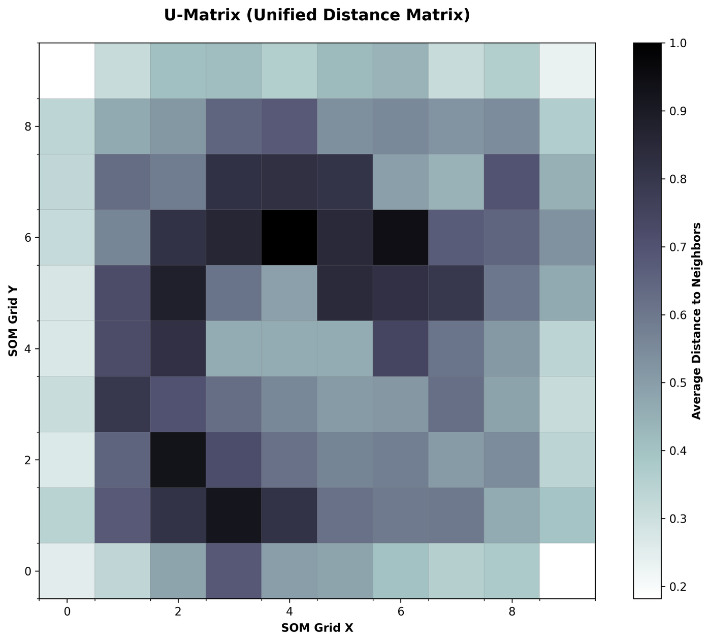
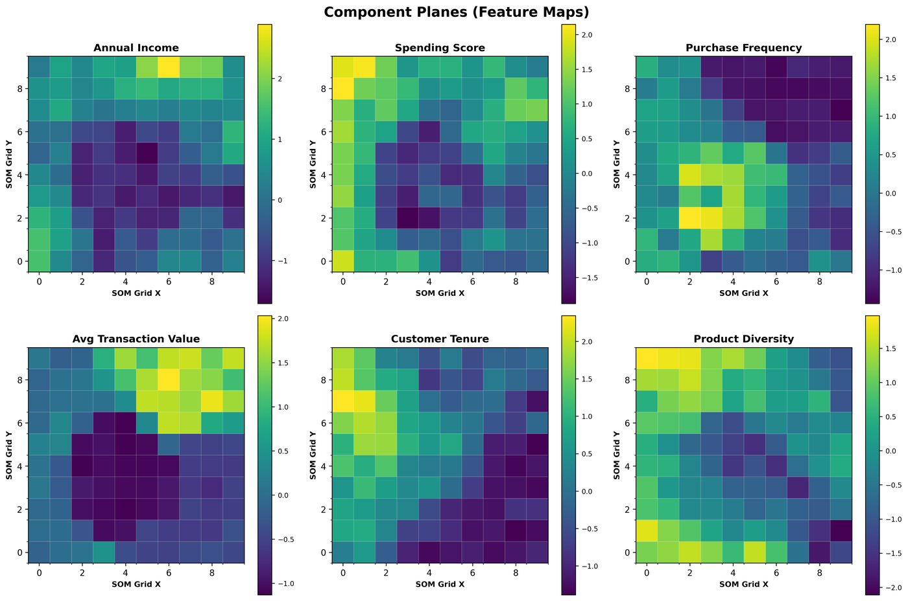
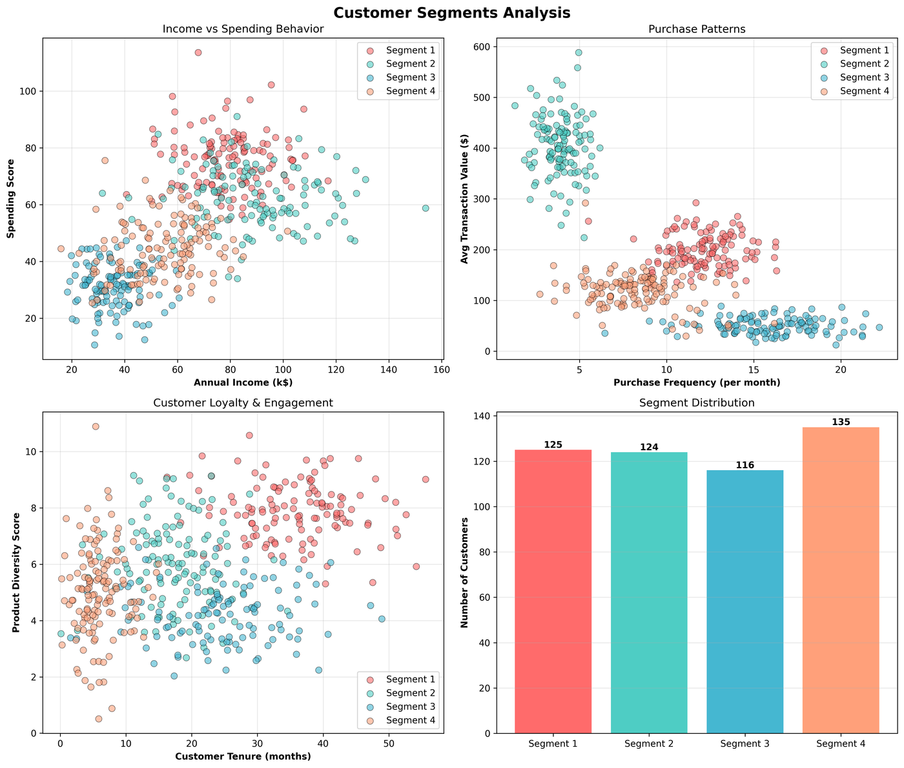

# Customer Segmentation with Self-Organizing Maps

Unsupervised segmentation of retail customers using a **Kohonen Self-Organizing Map (SOM)** followed by **K-means** on the trained neurons. The SOM gives a 2-D, interpretable map of six behavioural features; K-means turns that map into four business segments.

Author: Khaled Saber, M.Sc. AI Engineering, Near East University (Neural Networks and Deep Learning course, May 2026)

> **Data note:** the dataset is **synthetic** (500 customers generated from four behavioural archetypes), so the segments recover a structure that was built in. The goal of the project is the method and the evaluation, not a claim about real customers.

## Pipeline
1. Generate 500 customers x 6 features (income, spending score, purchase frequency, average transaction, tenure, product diversity)
2. Standardise features (z-score)
3. Train a 10 x 10 SOM (Gaussian neighbourhood, sigma 1.0, learning rate 0.5, 10,000 iterations)
4. Cluster the 100 neurons with K-means (k = 4) and map every customer to its best-matching unit's cluster
5. Profile segments, evaluate, visualise

## Results
| Metric | Value | Meaning |
|---|---:|---|
| Quantization error | 0.5775 | Average distance from a customer to its best-matching neuron (lower is better) |
| Topographic error | 0.3700 | Share of customers whose two closest neurons are not adjacent. Fairly high, so topology preservation is only moderate |
| Silhouette score | 0.4429 | Cluster separation (-1 to 1, higher is better) |
| Davies-Bouldin index | 0.8847 | Cluster compactness (lower is better) |

### Segments
| Segment | Share | Avg income | Spending score | Visits / month | Avg transaction | Tenure (months) |
|---|---:|---:|---:|---:|---:|---:|
| High-Value Loyal | 25.0% | $78.9k | 75.7 | 12.1 | $199 | 35.9 |
| Occasional High Spenders | 24.8% | $89.4k | 62.1 | 3.9 | $405 | 17.4 |
| Budget-Conscious | 23.2% | $35.7k | 31.0 | 15.9 | $50 | 24.7 |
| Emerging / New | 27.0% | $54.7k | 44.4 | 8.3 | $120 | 6.0 |

Suggested actions: VIP/loyalty programme for the loyal segment, occasion-based campaigns and visit incentives for occasional high spenders, bundles and value messaging for budget shoppers, onboarding and first-year retention campaigns for new customers.

### Figures
Figures below come from the original analysis run.

**U-Matrix** (dark = boundary between clusters)



**Component planes** (how each feature varies across the map)



**Customer segments in feature space**



More: `images/01_feature_distributions.png`, `02_correlation_matrix.png`, `05_hit_map.png`, `06_cluster_map.png`.

## Run it
```bash
pip install -r requirements.txt
python som_segmentation.py
```
Writes `data/customers.csv` and, in `outputs/`, the figures, `segment_profiles.csv`, `customer_segments.csv` and `som_metrics.csv`. The data generation is seeded; metrics can differ slightly across MiniSom versions.

## Structure
```
som-customer-segmentation/
  som_segmentation.py   data generation, SOM training, clustering, evaluation, plots
  data/customers.csv
  images/               figures from the original run
  requirements.txt
```

## Limitations and next steps
- Synthetic data; validate on a real retail dataset
- Tune grid size, sigma and learning rate (e.g. by minimising quantization and topographic error)
- Compare against plain K-means and Gaussian mixtures on the same features
